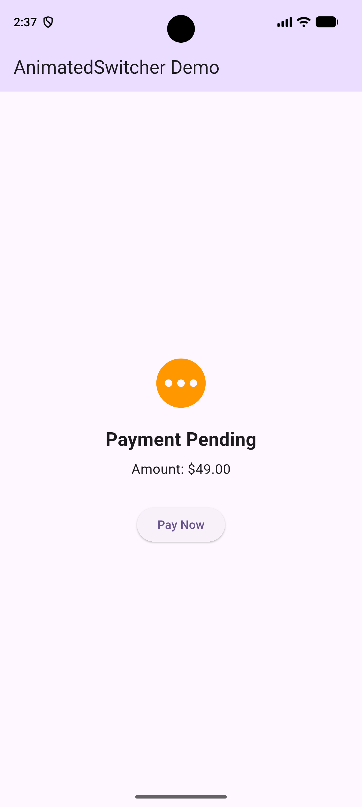
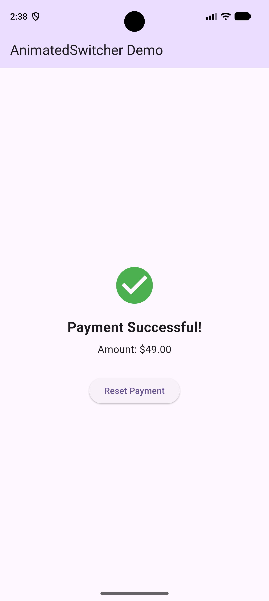

# AnimatedSwitcher Demo

A simple Flutter application demonstrating how the `AnimatedSwitcher` widget animates transitions between different UI states.

## About the Project

The app simulates a payment process. When the user clicks the **Pay Now** button, the payment status changes from pending to successful with a smooth animation. Clicking **Reset Payment** returns it to the original state.

## Getting Started

Clone the repository and open it in VS Code.

Run the following commands:

```bash
flutter pub get
flutter run
```

Make sure an Android emulator or another supported device is running.

## AnimatedSwitcher Properties

The demo focuses on three properties:

1. **duration:** Controls how long the animation takes. The demo uses 500 milliseconds and can be changed to 1500 milliseconds.
2. **transitionBuilder:** Defines the animation style. The demo compares `FadeTransition` and `SlideTransition`.
3. **switchInCurve:** Controls the timing of the incoming animation. The demo compares `Curves.linear` and `Curves.easeOut`.

These properties can be modified in `lib/screens/payment_screen.dart` to observe their effects.

## Screenshot

### Payment Pending


### Payment Successful
